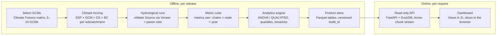

# Hydroclimate Uncertainty Fan — Implementation Guide

Oct 30, 2026 · Rory Hackett · Shared doc: https://claude.ai/artifact/DjQmH8wuoZwr6uSbcfs8jc

## Purpose and scope

Build a dashboard that shows **how wide** future catchment flow could be, **why** it is that wide, and **how often** it breaches a critical threshold. Everything is pre-computed offline; the dashboard only slices and draws.

The dashboard answers three questions:

1. **Where does the uncertainty come from?** Emissions, GCM, downscaling/bias correction, hydrological model parameters, or internal climate variability — and how that mix changes from the 2030s to the 2090s.
2. **How wide is the plausible range?** A P10–P90 fan of runoff or e-flow achievement, 2020–2100, relative to a 1990–2019 baseline.
3. **How robust is the system?** The share of ensemble runs that breach a supply or ecological threshold, per decade and per SSP.

Out of scope: live model runs, single-run forecasts, and assigning probabilities to SSPs (scenarios are shown side by side, never weighted).

Primary users are water resource planners and catchment modellers; a summary view serves policy and executive readers.

## Architecture

Models run offline once; the dashboard only slices pre-computed results.



Everything in the offline block runs in batch when inputs change (new downscaled release, recalibration); the API and dashboard only read versioned products, so no model ever runs on a user request.

## Experiment design: the modelling cascade

Each **chain** is one path through the cascade: SSP → GCM → downscaling → bias correction → hydrological parameter set → realisation. Variance partitioning only works if the chains form a (near-)crossed matrix, so design the matrix before running anything.

| Factor | Dimension name | Suggested levels | Typical count | Source |
| --- | --- | --- | --- | --- |
| Emissions scenario | `ssp` | SSP1-2.6, SSP2-4.5, SSP3-7.0 | 3 | CMIP6 |
| Global climate model | `gcm` | e.g. ACCESS-CM2, ACCESS-ESM1-5, EC-Earth3, MPI-ESM1-2-HR, NorESM2-MM | 5–10 | CMIP6, selected via Climate Futures |
| Downscaling | `ds` | RCM configurations (NARCliM2.0 WRF, CCAM) or statistical method | 2–3 | NARCliM / CCAM / CORDEX-Australasia |
| Bias correction | `bc` | e.g. QME, QDM, MRNBC | 2 | Applied in-house or supplied |
| Hydrological parameters | `hydro` | Behavioural or posterior parameter sets (GR4J, Sacramento, SIMHYD) | 10–30 | Calibration with DREAM, SCE-UA or GLUE |
| Internal variability | `member` | Initial-condition members or stochastic replicates | 1–5 | GCM members or a stochastic generator |

A 3 × 8 × 2 × 2 × 20 × 1 design is 1,920 chains — cheap for a rainfall-runoff model, expensive for a full Source river model. If full Source runs are too slow, run the parameter dimension on the rainfall-runoff component only and route a reduced set (e.g. 5 parameter sets chosen as quantiles of the full set's mean annual flow).

### Selecting GCMs with Climate Futures

1. For every available CMIP6 GCM, compute the change in annual mean temperature and annual (or cool-season) rainfall for 2060–2079 vs 1990–2019 over the catchment.
2. Classify each GCM into a matrix: temperature (*Warmer*, *Hotter*, *Much hotter*) × rainfall (*Much drier*, *Drier*, *Little change*, *Wetter*). Set class edges from the ensemble spread, e.g. terciles of ΔT and ±5% / ±15% for ΔP.
3. Record the share of GCMs in each cell — this is the consensus likelihood shown in the dashboard ("7 of 12 models: Hotter & Drier").
4. Pick GCMs so every occupied cell has at least one member, and always keep the "most likely", "wettest" and "driest" representatives. Prefer GCMs that are also boundary conditions in the downscaled products you use.
5. Screen out GCMs with poor historical skill over the region (seasonal rainfall cycle, ENSO/IOD teleconnections) before selection, and document why.

### Unbalanced designs

Downscaling products rarely cross every GCM with every RCM. Either (a) partition variance on the largest balanced sub-matrix and report the rest as additional envelope runs, or (b) use a method that handles missing cells (QUALYPSO, or a random-effects model — see Variance partitioning). Record which design each product used.

## Data model and storage

One master **metric cube** holds every chain's annual result; every dashboard product is derived from it. Store the cube as Zarr and the derived products as Parquet.

### Master cube: `metrics.zarr`

```text
dims:   ssp, gcm, ds, bc, hydro, member, node, metric, year
vars:   value    float32   annual metric value (absolute units)
        delta    float32   % change vs the chain's own 1990–2019 mean
        valid    bool      false where a chain does not exist (unbalanced design)
coords: year     1990–2100 (water year, e.g. Jul–Jun)
        node     gauge / storage / e-flow site ids
        metric   annual_runoff, low_flow_q90, storage_min, eflow_success, supply_reliability
chunks: one chunk per (node, metric), all chains and years
```

Size check: 1,920 chains × 111 years × 20 nodes × 5 metrics × 4 bytes ≈ 85 MB per variable. Chunking by (node, metric) means one dashboard request reads one ~0.9 MB chunk.

Use `delta` (per-chain change vs baseline) for the fan and the partitioning. It removes each chain's baseline bias, which is otherwise the largest spurious source of spread between hydrological parameter sets.

### Derived products (Parquet, partitioned by `node` / `metric`)

| Table | Grain | Key columns | Feeds view |
| --- | --- | --- | --- |
| `quantiles` | node × metric × ssp × year × slice | p05, p10, p25, p50, p75, p90, p95, min, max, n_chains | B, D |
| `variance` | node × metric × year | var_ssp, var_gcm, var_ds, var_bc, var_hydro, var_internal, var_interaction, var_total | A, B |
| `cascade` | node × metric × horizon × stage | stage order, p10, p50, p90 of the cumulative ensemble | A |
| `exceedance` | node × metric × threshold × ssp × decade | breach_share, n_chains, n_breach | C |
| `climate_futures` | gcm × ssp × horizon | dT, dP, class, cell_share | D (context) |
| `chains` | chain id | ssp, gcm, ds, bc, hydro, member, provenance | all (filters) |

`slice` in `quantiles` is a string such as `all`, `gcm=ACCESS-CM2` or `hydro=fixed:median`: one row set per factor level held fixed, which is what the stage slicers read. With 5 factors of 2–30 levels that is under 60 slices per node and metric.

### Metadata to carry with every product

- Baseline period and its definition (water year, calendar year).
- Chain list with provenance: GCM run id (e.g. `r1i1p1f1`), downscaling product and version, bias-correction method and reference dataset, Source model version, calibration run id.
- Weighting rule (default: equal weight per GCM, so a GCM with three members does not count three times).
- Smoothing rule used to separate response from internal variability.

## Pre-compute pipeline

Seven stages, each idempotent and keyed by chain id, run under Snakemake or Prefect so a single failed chain can be re-run without touching the others.

1. **Ingest climate forcing.** Pull daily rainfall, PET (or Tmin/Tmax/radiation to compute it) for each `ssp × gcm × ds` from the downscaled product. Clip to subcatchment polygons with area-weighted averaging (`xagg` or `regionmask`). Write one NetCDF per chain per subcatchment set.
2. **Bias-correct.** Apply each `bc` method against the observed reference (e.g. AGCD / SILO) over 1990–2019. Check: corrected historical runs must reproduce observed monthly means and the 1st/99th percentiles within tolerance.
3. **Write Source inputs.** Convert each corrected chain to the Source input format (CSV time series per subcatchment) under `inputs/{chain_id}/`.
4. **Run the hydrological model.** For each climate chain × parameter set, set parameters and inputs, run 1990–2100, and export node results. Run in parallel across Source instances (one Veneer port per worker).
5. **Compute annual metrics.** Reduce daily outputs to the metric list per water year: annual runoff, Q90 low flow, minimum storage, e-flow event success, supply reliability.
6. **Assemble the cube.** Concatenate chains into `metrics.zarr`; compute `delta` vs each chain's own 1990–2019 mean; set `valid`.
7. **Derive products.** Run variance partitioning, quantiles, cascade envelopes, exceedance and Climate Futures tables; write Parquet; run the QA checks (Validation section) and fail the build on any breach.

### Stage 4 sketch: batch Source runs with veneer-py

```python
# worker.py — one Source instance per worker, started with Veneer on `port`
import veneer

def run_chain(port, chain_id, params, out_dir):
    v = veneer.Veneer(port=port)
    # point the project's climate inputs at this chain's files
    set_climate_inputs(v, f"inputs/{chain_id}")      # your helper: input-set or data-source swap
    for name, value in params.items():                # e.g. GR4J x1..x4 for every functional unit
        v.model.catchment.runoff.set_param_values(name, value)
    v.configure_recording(enable=[{"RecordingVariable": "Downstream Flow Volume"}])
    v.run_model(start="01/07/1990", end="30/06/2100")
    flows = v.retrieve_multiple_time_series(criteria={"RecordingVariable": "Downstream Flow Volume"})
    flows.to_parquet(f"{out_dir}/{chain_id}.parquet")
```

The input-swap call depends on how the Source project is built (scenario input sets, data sources or a plug-in); confirm it with the Source modeller before scaling out. For runs on Linux or HPC without the GUI, the Source command-line runner with a per-chain input set is the alternative.

### Stage 6 sketch: assemble the cube

```python
import xarray as xr

cube = xr.open_mfdataset("metrics/*.nc", combine="by_coords")   # one file per chain
base = cube.value.sel(year=slice(1990, 2019)).mean("year")
cube["delta"] = 100 * (cube.value - base) / base
cube["valid"] = cube.value.notnull().any("year")
cube.chunk({"node": 1, "metric": 1}).to_zarr("metrics.zarr", mode="w")
```

## Variance partitioning

For every node, metric and year, split the ensemble variance of `delta` into one component per cascade stage plus internal variability. Start with the balanced ANOVA below (fast, transparent); move to QUALYPSO once the design is unbalanced or you need credible intervals on the shares.

$$
\sigma^2_{\text{total}}(t) = \sigma^2_{\text{SSP}}(t) + \sigma^2_{\text{GCM}}(t) + \sigma^2_{\text{DS}}(t) + \sigma^2_{\text{BC}}(t) + \sigma^2_{\text{Hydro}}(t) + \sigma^2_{\text{Interaction}}(t) + \sigma^2_{\text{IV}}
$$

### Step 1 — separate climate response from internal variability

Fit a smooth curve to each chain's `delta` series (4th-order polynomial, as in Hawkins & Sutton 2009, or a 30-year LOESS). The fitted curve is the chain's **response**; the residual is **internal variability (IV)**. IV variance is the residual variance pooled over chains and held constant in time. Where real initial-condition members exist, check the pooled residual variance against the member spread.

### Step 2 — main-effects ANOVA on the response (balanced design)

```python
import xarray as xr

FACTORS = ["ssp", "gcm", "ds", "bc", "hydro"]

def split_response(delta, deg=4):
    fit = delta.polyfit("year", deg, skipna=True)
    resp = xr.polyval(delta.year, fit.polyfit_coefficients)
    return resp, delta - resp

def partition(delta):
    """delta: dims FACTORS + member + year, one node and metric, fully crossed."""
    resp, resid = split_response(delta)
    resp = resp.mean("member")
    comps = {}
    for f in FACTORS:
        others = [g for g in FACTORS if g != f]
        comps[f] = resp.mean(others).var(f)          # main effect of f at each year
    total_resp = resp.var(FACTORS)                   # ddof=0 so the parts sum exactly
    comps["interaction"] = total_resp - sum(comps.values())
    comps["internal"] = resid.var("year").mean() + 0 * total_resp
    out = xr.Dataset(comps)
    out["total"] = total_resp + out["internal"]
    return out

parts = partition(delta)
shares = parts / parts["total"]                      # fractions per year, sum to 1
```

Run it per (node, metric) chunk and write the result to the `variance` table. Report the interaction term explicitly: a large interaction means "which GCM matters depends on the hydrological parameters" and is itself a finding.

### Step 3 — unbalanced designs and credible intervals: QUALYPSO

QUALYPSO (Evin et al., R package `QUALYPSO`) fits the response per chain, then estimates the main effects with a Bayesian ANOVA that tolerates missing GCM × RCM cells and returns uncertainty on every component. Run it as a separate R step that reads the cube and writes Parquet.

```r
library(QUALYPSO)
# Y: chains x years matrix of absolute values for one node and metric
# scenAvail: data.frame, one row per chain, columns ssp, gcm, ds, bc, hydro
out <- QUALYPSO(Y = Y, scenAvail = scenAvail, X = 1990:2100,
                Xfut = seq(2025, 2095, by = 10),
                listOption = list(typeChangeVariable = "rel"))
out$DECOMPVAR        # variance by component at each Xfut
```

Check argument names against the installed version; they have changed between releases. A random-effects model per horizon (`lme4::lmer(delta ~ 1 + (1|ssp) + (1|gcm) + (1|ds) + (1|bc) + (1|hydro))`) is an acceptable cross-check.

### Caveats to carry into the dashboard

- Variance from a factor with few levels is noisy: with 3 SSPs or 2 bias-correction methods, show the share with a bootstrap or posterior interval, not as an exact figure.
- The GCM ensemble is an ensemble of opportunity, not a random sample; its spread does not capture all sources of uncertainty.
- SSP variance describes scenario choice, not a probability. Label it "scenario spread".

## Dashboard views

One page per node, with a node picker, a metric picker and an SSP selector shared by all four views. Every view states its chain count ("n = 1,920 chains") and links to the chain list.

### A. Cascading variance ribbon

**Question it answers:** is the spread at a chosen horizon driven by climate forcing or by the catchment model?

- **Form:** a horizontal band that widens left to right through the stages SSP → GCM → downscaling → bias correction → hydro parameters → internal variability. Band height at each stage = P10–P90 of the cumulative ensemble; the increment added by each stage is shaded. A label on each step gives that stage's share of total variance.
- **Horizon control:** 2030s, 2050s, 2070s, 2090s (decadal mean of the response).
- **Headline:** climate share (SSP + GCM + DS + BC) vs hydrological share, e.g. "Climate 78% · Hydrology 14% · Variability 8%" — computed, never typed.
- **Data:** `cascade` table, computed as below.

```python
ORDER = ["ssp", "gcm", "ds", "bc", "hydro"]

def cascade(resp_h, iv_var, z=1.2816):            # resp_h: response averaged over one decade
    rows = []
    for k, stage in enumerate(ORDER, start=1):
        varying, fixed = ORDER[:k], ORDER[k:]
        ens = resp_h.mean(fixed + ["member"]).stack(chain=varying)
        p10, p50, p90 = ens.quantile([0.1, 0.5, 0.9], "chain").values
        rows.append(dict(stage=stage, p10=p10, p50=p50, p90=p90))
    last = rows[-1]                                  # add IV as a normal widening (approximation)
    lo = (last["p50"] - last["p10"]) ** 2 + z**2 * iv_var
    hi = (last["p90"] - last["p50"]) ** 2 + z**2 * iv_var
    rows.append(dict(stage="internal", p10=last["p50"] - lo**0.5,
                     p50=last["p50"], p90=last["p50"] + hi**0.5))
    return rows
```

The stage order changes the increments but not the shares in the `variance` table; keep the order fixed and say so in the caption.

### B. Shifting-horizon fan (Hawkins & Sutton style)

**Question it answers:** which source dominates in the near, mid and long term?

- **Upper panel:** `delta` vs year, 2020–2100. Centre line = ensemble-mean response for the selected SSP(s). Nested bands from the inside out: IV, hydro, BC, DS, GCM, SSP; each band's half-width = 1.645 × √(cumulative variance), i.e. a 90% range.
- **Lower panel:** stacked fractional-variance area chart (0–100%) on the same x-axis, one colour per source, same colours as the bands.
- **Toggle:** "Normal-approximation bands" (from `variance`) vs "Empirical P10–P90" (from `quantiles`). The empirical fan is the honest envelope; the partitioned one explains it. Show both lines when they disagree by more than 10%.
- **Horizon markers:** light vertical rules at 2035 and 2055 with labels near, mid, long term. The data, not the labels, should show which source dominates each period.

### C. Robust-decision threshold marker

**Question it answers:** how often does the system fail a limit we care about, and when does that become likely?

- **Inputs:** threshold from a preset list (town water security storage, minimum spawning-flow pulse, cease-to-pump level) or typed; breach rule chosen from three:
    1. *Annual:* share of chain-years in the decade below the threshold.
    2. *Persistent:* share of chains with at least N breach years in the decade (default N = 3).
    3. *Decadal mean:* share of chains whose decadal mean is below the threshold.
- **Form:** the threshold drawn as a labelled line across the fan in view B, plus a decade × SSP grid of breach shares (2030s–2090s by 3 SSPs), each cell showing share and n, e.g. "38% (730 of 1,920)".
- **Data:** `exceedance` table for presets; for a typed threshold, compute in the browser from the loaded chunk.

### D. Stage slicers

**Question it answers:** what is left if we hold one source fixed?

- **Controls:** one "hold fixed" dropdown per factor (`all` or a single level) plus two presets: *Climate spread only* (hydro = median parameter set) and *Hydrological-parameter spread only* (pick one SSP × GCM × DS × BC chain, e.g. SSP2-4.5 / ACCESS-CM2).
- **Behaviour:** redraws the empirical fan in B and the breach grid in C for the filtered chains; shows the filtered fan over the full fan in grey so the reduction is visible.
- **Implementation:** the client loads the (node, metric) chunk once as Arrow (1,920 chains × 111 years ≈ 0.85 MB) and computes quantiles and breach shares locally, in under 50 ms. The precomputed `quantiles` slices serve the first paint and exports.
- **Context panel:** the Climate Futures matrix for the selected horizon, highlighting the cells of the GCMs currently included.

## Tech stack and API

A Python pre-compute stack, a thin read-only API, and a browser client that does the slicing. Swap the client for Streamlit or Panel if the first goal is an internal prototype.

| Layer | Recommended | Why | Prototype alternative |
| --- | --- | --- | --- |
| Orchestration | Snakemake or Prefect | Per-chain targets, resumable, HPC-friendly | Python script with a chain manifest |
| Climate processing | xarray, dask, xagg / regionmask, xclim (bias correction via `xclim.sdba`) | Labelled n-d arrays, lazy, chunked | Same |
| Hydrology | eWater Source + veneer-py, or Source command-line runner | Existing calibrated models | Rainfall-runoff only (e.g. GR4J in `hydrogr` or Python) |
| Variance | numpy / xarray ANOVA; R `QUALYPSO` via a separate R step | Transparent first, Bayesian when needed | ANOVA only |
| Storage | Zarr (cube) + Parquet (products) on S3 / Azure Blob | Chunked reads, columnar filters | Local files |
| API | FastAPI + DuckDB over Parquet | SQL on Parquet with no database server | Streamlit reads Parquet directly |
| Client | React + D3 or Observable Plot; Apache Arrow JS for chunk transfer | Custom fans and ribbons, fast local slicing | Streamlit / Panel + Plotly |

### Endpoints (all GET, all cacheable)

| Endpoint | Returns | Backed by |
| --- | --- | --- |
| `/nodes`, `/metrics`, `/chains` | Catalogues and chain provenance | `chains` |
| `/variance?node&metric` | Variance components by year | `variance` |
| `/cascade?node&metric&horizon` | Stage envelopes | `cascade` |
| `/quantiles?node&metric&ssp&slice` | Fan quantiles by year | `quantiles` |
| `/exceedance?node&metric&threshold_id` | Breach grid | `exceedance` |
| `/cube?node&metric` | Arrow IPC stream of `delta` for all chains | `metrics.zarr` chunk |
| `/futures?horizon&ssp` | Climate Futures matrix | `climate_futures` |

Version every product build (`build_id` in every response) so a screenshot can be traced to the chain set that produced it.

### Performance budgets

- First paint of a node page: under 1.5 s (four small Parquet queries).
- Slicer redraw: under 100 ms (local quantiles on a ~0.85 MB chunk).
- Full product rebuild after new chains: overnight batch; incremental if only one factor level is added.

## Validation, QA and communication guardrails

The build fails if any automated check fails; the guardrails are design rules every view must follow.

### Automated checks (run in pipeline stage 7)

- [ ] **Historical skill:** every chain driven by bias-corrected historical climate reproduces observed 1990–2019 mean annual flow within ±10% and the flow-duration curve Q10/Q50/Q90 within ±20% at each gauged node.
- [ ] **Parameter sets:** each hydro parameter set meets the calibration acceptance criteria (e.g. NSE ≥ 0.7 and |bias| ≤ 10%) on observed climate.
- [ ] **Completeness:** chain count per factor level matches the design; missing cells listed in the build report.
- [ ] **Closure:** variance components sum to the total within 0.1% (balanced ANOVA).
- [ ] **Agreement:** partitioned 90% band and empirical P05–P95 differ by less than 20% at every decade; otherwise flag the node.
- [ ] **Stability:** bootstrap over GCMs (resample with replacement, 500 draws); flag any variance share whose 90% interval is wider than 30 percentage points.
- [ ] **Monotonic quantiles:** p05 ≤ p10 ≤ … ≤ p95 for every row.

### Communication guardrails

- Never show a single chain as "the projection". Single chains appear only inside view D and always over the full grey envelope.
- Label SSPs as scenarios. Do not pool them into one fan without saying so, and never print a probability for an SSP.
- State n and the GCM list on every view; state "ensemble of opportunity — this ensemble does not capture all sources of uncertainty".
- Show change relative to baseline by default; absolute values only with the baseline drawn.
- Use one colour per uncertainty source across all views (A, B and the stacked share chart), and a neutral grey for the envelope.
- Breach shares carry their breach rule in the label ("Persistent: ≥ 3 years below 15 ML/d in the decade").

## Delivery plan

Five phases; each ends at a gate the next phase depends on. Durations are indicative for one catchment and a team of two.

| Phase | Indicative length | Deliverable | Gate to pass |
| --- | --- | --- | --- |
| 0. Design | 2 weeks | Factor matrix, Climate Futures GCM selection, metric and threshold list, chosen breach rules | Water planners sign off the metrics and thresholds |
| 1. Thin slice | 3 weeks | 1 node, 2 SSPs, 3 GCMs, 1 DS, 1 BC, 5 hydro sets run end to end; cube + ANOVA; Streamlit view B | Variance closure and historical skill checks pass |
| 2. Full cascade | 4–6 weeks | All chains for all nodes; QUALYPSO step; all Parquet products; QA report | All automated checks pass or flagged nodes are accepted |
| 3. Dashboard | 4 weeks | API + client with views A–D, Climate Futures panel, exports | Usability test with 5 planners: each answers the three purpose questions unaided |
| 4. Operate | ongoing | Rebuild on new downscaled releases or recalibration; versioned `build_id` | A rebuild reproduces the previous build's products exactly from the same inputs |

### Open questions to settle in Phase 0

- Which downscaled product(s) and bias-correction methods are authoritative for this catchment?
- Is the Source model fast enough for the full parameter dimension, or is the reduced routing set needed?
- Which thresholds and breach rules are regulatory, and which are exploratory?
- Is internal variability from GCM members, residuals, or a stochastic generator?
